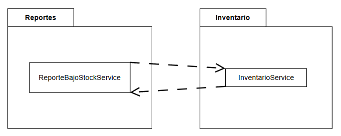
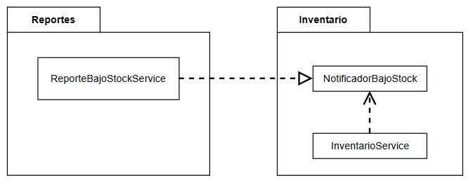

# Documentación de refactorización de la parte 1

## 1. Refactorización de `InventarioService`

**Antes:** `actualizarInventario()` superaba las 35 líneas y concentraba la validación de datos, la búsqueda del producto, el cálculo y actualización del stock, el cálculo del reorden, el registro de movimientos y la emisión de alertas.

**Después:** se delegaron estas responsabilidades en seis métodos privados: `datosValidos()`, `buscarProducto()`, `calcularNuevoStock()`, `calcularCantidadReorden()`, `registrarMovimiento()` y `emitirAlerta()`. El método principal conserva la coordinación del proceso.

**Evidencia cuantitativa:** contando las líneas físicas no vacías, incluidas la firma y las llaves, la versión refactorizada tiene 27 líneas (entre las lineas 18-54). La versión original superaba las 35 (entre las lineas 19-62). El conteo exacto de esta última debe verificarse en el código anterior para establecer la reducción precisa. Se utilizó el mismo criterio de conteo, excluyendo líneas vacías.

## 2. Eliminación de los `switch` duplicados

**Antes:** `ClasificadorProducto` y `EtiquetadoProducto` contenían sendos `switch` con cuatro alternativas: `LIBRO`, `ELECTRONICO`, `ROPA` y `ALIMENTO`.

**Después:** se implementaron `calcularRecargoEnvio()` y `generarEtiqueta()` mediante métodos abstractos en `TipoProducto`, con una implementación para cada constante. Las dos clases consumidoras delegan el comportamiento al tipo de producto, eliminando los `switch` sin cambiar sus firmas públicas.

**Evidencia:** `ClasificadorProducto` invoca `producto.getTipo().calcularRecargoEnvio(producto.getPrecio())`, mientras que `EtiquetadoProducto` invoca `producto.getTipo().generarEtiqueta(producto.getNombre())`. La inspección del código refactorizado confirma que ninguna de las dos clases selecciona el comportamiento mediante `switch` o cadenas de `if-else`.

## 3. Resultados de las pruebas

La ejecución final de `mvn test` produjo el siguiente resultado:

| Clase de prueba | Pruebas | Fallos | Errores |
|---|---:|---:|---:|
| `InventarioServiceTest` | 6 | 0 | 0 |
| `ClasificadorProductoTest` | 4 | 0 | 0 |
| `EtiquetadoProductoTest` | 4 | 0 | 0 |
| **Total** | **14** | **0** | **0** |

**Resultado final:** `BUILD SUCCESS`. Las 14 pruebas pasaron y ninguna fue omitida.

Este resultado corresponde al código final. Para documentar los resultados antes y después de cada refactorización, es necesario ejecutar y registrar `mvn test` en cada etapa. El log final, por sí solo, no demuestra los resultados de las etapas intermedias.

## 4. Decisiones de diseño

**Decisión 1: mantener el cálculo de reorden como método privado.** Se eligió esta alternativa porque la fórmula es sencilla, solo se utiliza dentro de `InventarioService` y no tiene actualmente una razón de cambio independiente. Así se evita crear una clase adicional sin necesidad ni exponer el cálculo a otros componentes. Si la lógica se vuelve más compleja o necesita reutilizarse, se podrá extraer a una clase colaboradora.

**Decisión 2: utilizar un `enum` con métodos abstractos.** Se eligió esta alternativa porque los tipos de producto constituyen un conjunto cerrado y cada uno tiene sus propias reglas de recargo y etiquetado. Implementar ambos comportamientos en las constantes de `TipoProducto` elimina los `switch` duplicados sin añadir una jerarquía de clases. Si posteriormente se requieren dependencias inyectadas por Spring para cada comportamiento, se podrá evaluar el uso de estrategias independientes.

# Diagnóstico de dependencia cíclica entre paquetes

## 1. Problema detectado

Se ejecutó la prueba de arquitectura con el comando:

```bash
mvn test -Dtest=ArquitecturaPaquetesTest
```

La prueba `losPaquetesNoDebenTenerDependenciasCiclicas` falló porque ArchUnit detectó una dependencia cíclica entre los paquetes `inventario` y `reportes`.

El resultado relevante fue:

```text
Architecture Violation [Priority: MEDIUM]
Cycle detected: Slice inventario ->
                Slice reportes ->
                Slice inventario

Tests run: 1, Failures: 1, Errors: 0, Skipped: 0
BUILD FAILURE
```

## 2. Evidencia del acoplamiento

El ciclo se produce por las siguientes dependencias:

- **`inventario → reportes`:** `InventarioService` mantiene una referencia a `ReporteBajoStockService`, recibe esta clase mediante un método setter y llama a `generarReporte()` durante `actualizarInventario()`.
- **`reportes → inventario`:** `ReporteBajoStockService` recibe `InventarioService` en su constructor y mantiene una referencia a este servicio.

Por tanto, ambos paquetes dependen directamente del otro. Esto genera un ciclo de dependencias que dificulta la separación de responsabilidades y aumenta el acoplamiento entre los componentes.

## 3. Diagrama de paquetes

El siguiente diagrama representa la situación identificada antes de resolver el problema:



Las flechas en sentidos opuestos representan el ciclo detectado por ArchUnit.

## 4. Registro de la prueba en rojo

La ejecución de `ArquitecturaPaquetesTest` constituye la evidencia inicial del problema arquitectónico. El test establece que los paquetes deben estar libres de dependencias cíclicas, pero el código original incumple esa regla.

Se debe conservar el commit que contiene la prueba fallida como punto de referencia antes de aplicar la solución. De esta forma, queda documentado el diagnóstico inicial y se puede comparar con el resultado posterior a la refactorización.

### Decisión de diseño 3: Ubicación de la interfaz `NotificadorBajoStock`

La interfaz `NotificadorBajoStock` se ubica en `inventario` porque este paquete contiene la lógica central del sistema y tiene un mayor nivel de abstracción que `reportes`,el cual esta encargado de generar los reportes del inventario.

De esta forma, `InventarioService` depende de la interfaz, mientras que `ReporteBajoStockService` la implementa. Así, el dominio no depende directamente de una implementación de reportes, se reduce el acoplamiento y se rompe el ciclo de dependencias.

#### Diagrama de paquetes de resultado de refactorizacion descrita en decisión de diseño 3



### Decisión de diseño 4: Granularidad de la notificación

Se eligió `notificar(Producto, cantidadReorden)` porque `actualizarInventario()` procesa un solo producto por llamada. La notificación por evento permite informar de manera específica qué producto requiere reabastecimiento y en qué cantidad, manteniendo una interfaz sencilla y coherente con el flujo actual.

Una notificación por lote, como `notificar(List<Producto>)`, sería preferible si una operación modificara varios productos, por ejemplo, durante una compra masiva o una actualización de inventario, ya que permitiría agrupar las alertas y reducir las llamadas al notificador.